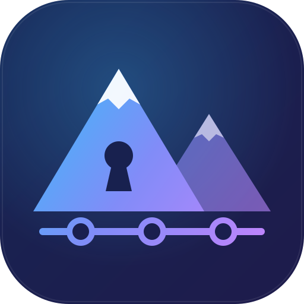
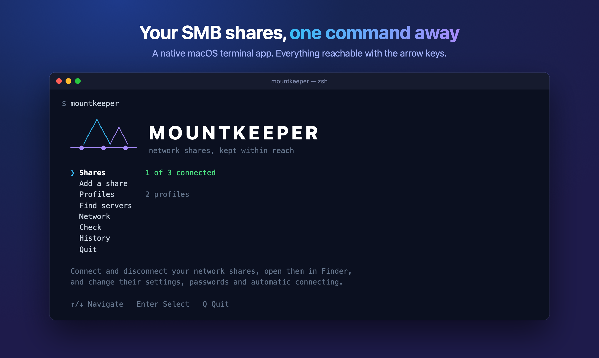
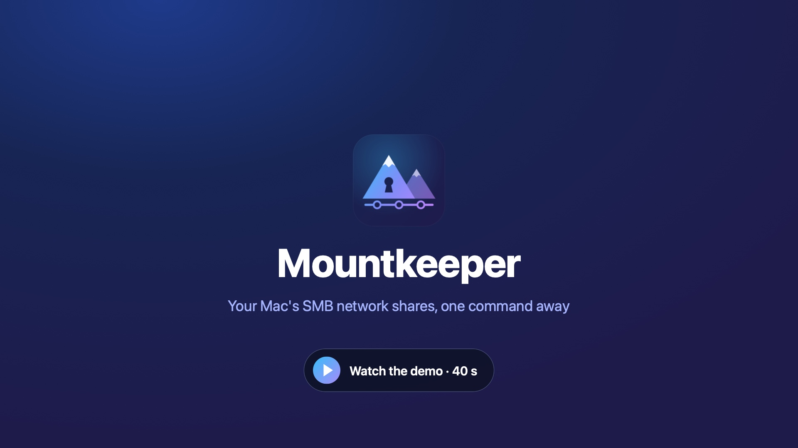
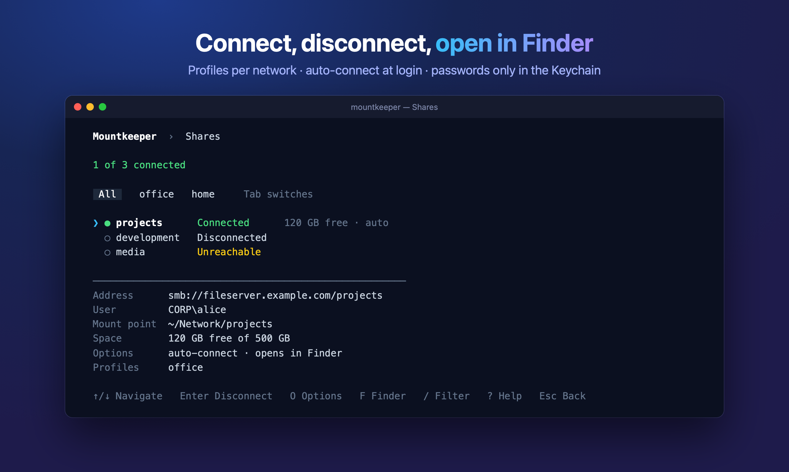
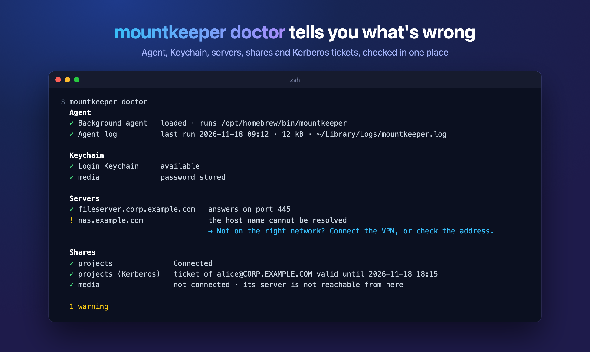
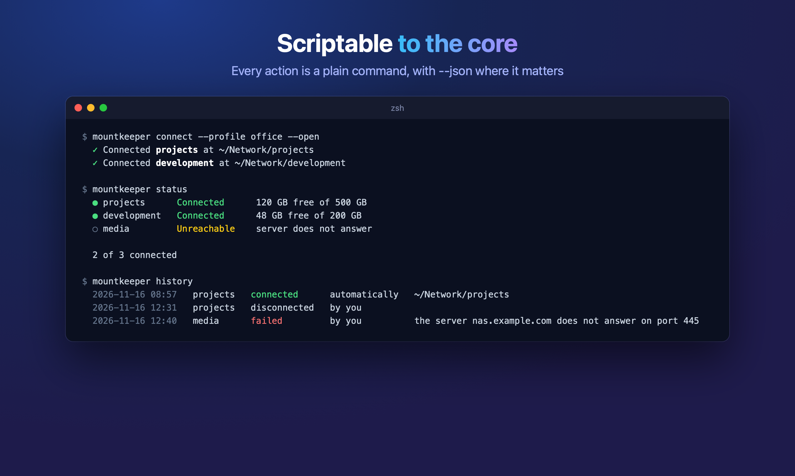

<p align="center">
  
</p>

<h1 align="center">Mountkeeper</h1>

<p align="center">A native macOS SMB share manager for the terminal.</p>
<div align="center">

| Reference | Product Hunt |
| :-------: | :----------: |
| [](https://godoc.org/github.com/sanriodev/mountkeeper) | <a href="https://www.producthunt.com/products/mountkeeper?embed=true&amp;utm_source=badge-featured&amp;utm_medium=badge&amp;utm_campaign=badge-mountkeeper" target="_blank" rel="noopener noreferrer"></a> |

</div>

Mountkeeper remembers your network shares and connects, disconnects and opens
them with one command — instead of clicking through Finder's *Connect to
Server* dialog or remembering mount commands. Passwords live in the macOS
Keychain and nowhere else; in an Active Directory domain, shares can sign in
with your Kerberos ticket instead.

## Features

- **Native macOS Keychain** — passwords are stored only in the login
  Keychain, never in files, logs or on a command line ([Security](#security))
- **Active Directory & Kerberos** — per share, sign in with a Kerberos ticket
  instead of a password; Mountkeeper scans for your tickets and you toggle
  which one a share uses ([Active Directory & Kerberos](#active-directory--kerberos))
- **Finder integration** — open shares in Finder after connecting, and
  recognise shares that were connected through Finder ([Status](#status))
- **Automatic connecting** — at login and whenever the network changes, by a
  small LaunchAgent instead of a daemon ([Automatic connecting](#automatic-connecting))
- **Profiles that follow the network** — connect a group of shares while you
  are on a certain network (DNS domain or router) ([Profiles](#profiles))
- **Dead-mount detection** — shares left behind by sleep, a dropped VPN or a
  change of network are shown as *Not responding*, cleaned up by the agent and
  can be force-disconnected ([Status](#status))
- **macOS notifications** — told once when a share stops connecting by
  itself, for example after a password change ([Automatic connecting](#automatic-connecting))
- **`mountkeeper doctor`** — checks the agent, the Keychain, the servers,
  the shares and their Kerberos tickets in one place ([Diagnosis](#diagnosis))
- **Connection history** — what was connected, disconnected or failed, and by
  whom ([History](#history))
- **Interactive interface and scripting** — everything reachable with the
  arrow keys, and every action also a plain command, with `--json` where it
  matters ([Usage](#usage))
- **Homebrew tap, built from source** — no prebuilt binaries ([Install](#install))

<p align="center">
  
</p>

Run `mountkeeper` on its own and everything is reachable with the arrow keys,
Enter and Esc. Every action is also a plain command for scripts and muscle
memory.

macOS only, by design: it uses the system's own SMB client, Keychain,
launchd and Finder rather than reimplementing any of them.

<p align="center">
  <a href="https://www.youtube.com/watch?v=z6dEIQFJCD4">
    
  </a>
</p>

## Install

```sh
## add the tap with absolute url
brew tap sanriodev/mountkeeper https://github.com/sanriodev/mountkeeper
## trusting the tap might not always be necessary.
## homebrew will also prompt you to trust the tap before installing.
brew trust sanriodev/mountkeeper
## then install from the tap
brew install mountkeeper
```


The explicit URL is needed because the tap lives in the application
repository itself (Homebrew would otherwise look for `homebrew-mountkeeper`).
Homebrew compiles Mountkeeper from the tagged release source; no prebuilt
binaries are downloaded.

To uninstall, `brew uninstall mountkeeper` is enough: the background agent
(if any) notices that Mountkeeper is gone and removes itself within a few
minutes — Homebrew formulae cannot run anything on uninstall, so the agent
cleans up after itself. Your settings (`~/.config/mountkeeper`) and the
passwords in the Keychain (service `mountkeeper`, see *Keychain Access*) are
kept for a reinstall; delete them by hand to remove everything.

From a checkout (needs Go and the Xcode Command Line Tools):

```sh
make build      # → bin/mountkeeper
make install    # → /usr/local/bin/mountkeeper
```

## Usage

```sh
mountkeeper                                             # the interactive interface
mountkeeper add smb://fileserver.example.com/projects   # register (asks for the details)
mountkeeper connect                                     # straight to the connection manager
mountkeeper connect projects --open                     # connect and show in Finder
mountkeeper open projects                               # connect if needed, then open Finder
mountkeeper disconnect projects
mountkeeper disconnect --all
```

| Command | What it does |
| --- | --- |
| `add <smb-url>` | Register a share. Asks for name, user, Keychain, mount point, Finder and auto-connect; `--yes` takes the defaults, flags answer individual questions. |
| `edit <share>` | Change name, address, user, mount point or the Finder option. Asks interactively without flags. |
| `remove <share>` | Unregister a share and delete its Keychain item. |
| `list` | Registered shares with URL, mount point and options. |
| `status [share...]` | Live state of every share: connected (with free space), available, or server unreachable. `--json` for scripts. |
| `info <share>` | Everything about one share. |
| `connect [share...]` | Connect by name, `--profile <name>`, `--all`, or interactively without arguments. `--open` / `--no-open` control Finder. |
| `disconnect [share...]` | Disconnect by name, `--profile <name>` or `--all`. `--force` unmounts even with open files. |
| `open <share>` | Open the share in Finder, connecting first if necessary. |
| `profile [add\|remove\|list\|auto]` | Group shares into profiles that connect together — on request, or automatically on a certain network. |
| `network` | The network the Mac is on, and the profiles it activates. |
| `history [share]` | When shares were connected or disconnected, by whom, and what failed. |
| `autoconnect [share] [true\|false]` | Connect a share automatically at login. Without arguments: show the settings. |
| `find [host]` | Without a host: SMB servers announced on the local network. With a host: the shares it offers. |
| `credentials [list\|set\|remove]` | Show how shares sign in and which passwords are stored, replace or delete one. `set --stdin` reads it from a pipe. |
| `credentials scan [share]` | List your Kerberos tickets and which ones suit a share. |
| `credentials use <share> kerberos\|password` | Choose whether a share signs in with a Kerberos ticket (`--principal` to pick one) or its password. |
| `doctor` | Check the agent, Keychain, servers, shares and Kerberos tickets, and say what to do. `--fix` repairs the agent, `--json` for scripts. |

Shell completion (including share names) is installed by Homebrew; otherwise
see `mountkeeper completion --help`.

### The interactive interface

`mountkeeper` without a command opens the main menu; `mountkeeper connect`
without arguments jumps straight to the list of shares. Enter goes in, Esc
goes back, and the line at the bottom always shows the keys that work.

<p align="center">
  
</p>

```
  Mountkeeper  ›  Shares

  1 of 3 connected

  All   office   home     Tab switches

  ❯ ● projects      Connected      120 GB free · auto
    ○ development   Disconnected
    ○ media         Unreachable

  ────────────────────────────────────────────
  Address      smb://fileserver.example.com/projects
  User         CORP\alice
  Mount point  ~/Network/projects
  Space        120 GB free of 500 GB
  Options      auto-connect · opens in Finder
  Profiles     office

  ↑/↓ Navigate   Enter Disconnect   O Options   F Finder   / Filter   ? Help   Esc Back
```

In the list of shares:

| Key | Action |
| --- | --- |
| `Enter` | Connect or disconnect the selected share; for a share whose server no longer answers, force-disconnect it (asks first) |
| `O` | Options of the share: edit, password, sign-in (Kerberos), automatic connecting, Finder, profiles, history, force disconnect, remove |
| `F` | Open in Finder (connects first if necessary) |
| `C` / `X` | Connect / disconnect all shares shown |
| `A` | Toggle connecting automatically at login |
| `N` | Add a share |
| `/` | Filter by name or server |
| `Tab` | Switch profile |
| `?` | All keys |
| `Esc` / `Q` | Back / quit |

`C` and `X` act on what is shown, so together with a profile tab or a filter
they connect or disconnect exactly that group.

The other entries of the main menu: **Add a share** is a form (↑/↓ between
fields, Space toggles, Ctrl+S saves). **Profiles** creates profiles, chooses
their shares and binds them to a network. **Find servers** lists file servers
on the local network and starts the form with the server filled in.
**Network** and **History** show what the commands of the same name print,
and **Check** runs the [diagnosis](#diagnosis); Enter on a finding about the
background agent repairs it. Anything destructive asks first, with *No*
preselected.

A share whose automatic connecting is paused is marked *auto paused* in the
list, the main menu counts it (*1 of 3 connected · 1 paused*), and its details
say why and since when — and what resumes it.

### Profiles

A profile is a named group of shares — everything you need at the office,
for example. A share can be in several profiles.

```sh
mountkeeper profile add office projects development
mountkeeper connect --profile office
mountkeeper disconnect --profile office
mountkeeper profile remove office development   # take one share out
mountkeeper profile remove office               # delete the profile
```

#### Profiles that follow the network

A profile can be bound to a network. While the Mac is on it, the background
agent keeps the profile's shares connected; when you leave, it disconnects
the ones it connected.

```sh
mountkeeper profile auto office --here                           # the network you are on now
mountkeeper profile auto office --rule domain:corp.example.com   # or choose the rule yourself
mountkeeper profile auto office --off
mountkeeper network                                              # what is known about this network
```

Networks are recognised by what needs no special permission: the DNS search
domain (`domain:`), which also holds on other floors of an office and over
VPN, or the router's hardware address (`router:`), which identifies a single
subnet. The Wi-Fi name (`ssid:`) works only where macOS reveals it to
command-line tools, which recent versions do not by default.

### Status

```
$ mountkeeper status
  ● projects      Connected      120 GB free of 500 GB
  ○ development   Disconnected   server available
  ○ media         Unreachable    server does not answer

  1 of 3 connected
```

Every share's server is probed briefly (`--no-check` skips that). For shares
that are not connected this tells "could connect now" from "not on this
network". For connected shares it finds the ones whose server no longer
answers — what sleep, a dropped VPN or a change of network leave behind:

```
$ mountkeeper status
  ● projects   Not responding   server does not answer · mountkeeper disconnect projects --force
```

Such a share stays in the mount table and cannot be connected again until it
is gone; `mountkeeper disconnect projects --force` (or Enter in the share
list) removes it. The background agent does that by itself for connections it
made — see [Automatic connecting](#automatic-connecting).

A share whose automatic connecting is paused says why, with the command that
resumes it below the table:

```
  ○ media   Disconnected   auto-connect paused: password rejected

  ! media: connects automatically again after: mountkeeper credentials set media
```

`mountkeeper status --json` prints the same for scripts; the `state` field is
one of `connected`, `connected_elsewhere`, `not_responding`, `available`,
`unreachable` or `disconnected` (not probed), and
`auto_connect_paused_reason` is one of `no-password`, `rejected`,
`kerberos-no-ticket`, `kerberos-rejected` or `unknown`.

### When something goes wrong

Errors say what happened and, on the next line, what to do about it:

```
$ mountkeeper connect projects
Error: the server fileserver.example.com does not answer on port 445
  Check the network or VPN connection. "mountkeeper status" shows which servers answer.
```

A mistyped share name gets a suggestion, a busy volume names the app that
keeps it open, and a rejected password points to `credentials set`.

### How state is detected

Mountkeeper keeps no record of what is connected. Status always comes from
the kernel mount table (`getfsstat(2)`, the data behind `mount`), so a share
you connected through Finder shows up as connected too — reported as
*Connected at /Volumes/…* when it is mounted somewhere other than its
configured mount point.

### Mount points

Shares are mounted under `~/Network/<name>` unless you choose another path
(`add --mount-point`, or later `mountkeeper edit <share> --mount-point <dir>`).
Mountkeeper creates the directory when needed and refuses to mount over a
file, a non-empty directory, or a directory another volume is mounted on.
After disconnecting, the empty directory is removed again.

### Automatic connecting

`mountkeeper autoconnect <share> true` keeps a single share connected
whenever its server is in reach; a network-bound profile does the same for a
group, limited to one network.

Both are carried out by a per-user LaunchAgent
(`~/Library/LaunchAgents/com.github.sanriodev.mountkeeper.autoconnect.plist`)
that runs `mountkeeper connect --auto` at login, whenever macOS changes its
network configuration (joining a Wi-Fi, connecting a VPN, waking up
elsewhere), and every five minutes as a fallback. It exists only while
something automatic is configured. There is no daemon.

The agent starts Mountkeeper through a small check: if the `mountkeeper`
binary has been gone for a minute (it was uninstalled — a `brew upgrade` only
removes it for a moment), the agent deletes its plist and unloads itself.
Agents written by an older version are brought up to date by the next
`mountkeeper` command, and one that is needed but missing is set up again.

The agent never prompts, and it is careful:

- Servers that do not answer are skipped silently; right after a network
  change it tries a few times before giving up until the next trigger.
- If a server rejects the stored password, that share is **paused** instead
  of retried — repeated failed logins could lock your account. Connecting by
  hand or `mountkeeper credentials set <share>` resumes it.
- A Kerberos share without a valid ticket waits: the agent checks for the
  ticket on every run (that check is local) and connects as soon as one is
  there again. A ticket the server rejects pauses the share like a password.
- When a share is paused, a macOS notification says so — once, not on every
  run. Set `notifications: false` in the configuration to turn that off.
  The first notification may need to be allowed in *System Settings ›
  Notifications*.
- A share you disconnect by hand stays disconnected until you connect it
  again or leave its network, instead of coming straight back.
- A connection the agent made whose server stops answering (sleep, a dropped
  VPN, another network) is **force-disconnected** once the server has been
  silent for a minute, so that it can be connected again as soon as the
  server is back. Shorter outages are sat out. Shares you connected by hand
  are never force-disconnected; the log notes them once.

Its log is `~/Library/Logs/mountkeeper.log`. It is cut down to its newer half
once it grows beyond 256 kB.

## Active Directory & Kerberos

In an Active Directory domain you usually have a Kerberos ticket already —
from `kinit`, the macOS Kerberos SSO extension or Platform SSO. A share can
sign in with that ticket instead of a password. No password is then needed
in the Keychain, and a changed domain password does not stop the share from
connecting.

Kerberos is chosen **per share**, and you decide which ticket it uses:

```sh
mountkeeper credentials scan projects            # your tickets, and which ones suit the share
mountkeeper credentials use projects kerberos    # sign in with the suitable ticket
mountkeeper credentials use projects kerberos --principal alice@CORP.EXAMPLE.COM
mountkeeper credentials use projects password    # back to the Keychain password
```

```
$ mountkeeper credentials scan projects
  ● alice@CORP.EXAMPLE.COM   valid until 2026-11-18 18:15   suits projects · already signed in to fileserver.corp.example.com
```

A ticket *suits* a share when its name is the share's user and its realm is
the share's domain (`CORP` matches `CORP.EXAMPLE.COM`). Without
`--principal`, `use … kerberos` takes the one ticket that suits; with several,
it asks you to choose.

In the interactive interface: **Shares › O › Sign-in**. The screen scans for
tickets when it opens, shows how long each one is valid and whether it suits
the share, and Enter switches between *Password from the Keychain* and a
ticket (● marks the current choice). **R** scans again.

What to expect:

- **No fallback.** With Kerberos chosen and no valid ticket, connecting fails
  and says how to get one (`kinit user@REALM`, or your company sign-in). It
  never silently uses the password.
- **The password stays.** The Keychain item is kept when you switch to
  Kerberos, so switching back needs nothing.
- **Automatic connecting** waits for a ticket instead of pausing for good, and
  tells you once by notification.
- `mountkeeper doctor` shows each Kerberos share's ticket and when it expires;
  `status`, `info` and `credentials list` show how each share signs in.

Mountkeeper only reads tickets (`klist -A --json`); it never obtains them,
and it never switches your default credential cache. The share's principal is
handed to macOS's own SMB client as the user of the address
(`smb://alice%40CORP.EXAMPLE.COM@server/share`), which then signs in with that
principal's ticket.

## Diagnosis

<p align="center">
  
</p>

`doctor` checks whether the background agent is installed, loaded, up to date
and runs *this* `mountkeeper` (a build from a checkout can take it over);
whether the Keychain is usable and holds the passwords; whether every server
resolves and answers; and which shares are paused, not responding, blocked by
their mount point or missing a Kerberos ticket. Each finding says what to do.

- `--fix` repairs the background agent and changes nothing else.
- `--deep` also reads every stored password, which may make macOS ask for
  Keychain access.
- `--json` prints the findings for scripts; the exit status is 1 if any check
  failed.

In the interactive interface: **Check** in the main menu.

### History

```
$ mountkeeper history
  2026-11-16 08:57   projects   connected      automatically   ~/Network/projects
  2026-11-16 12:31   projects   disconnected   by you
  2026-11-16 12:40   media      failed         by you          the server nas.example.com does not answer on port 445
```

Every connect, disconnect and failed attempt is recorded locally in
`~/.config/mountkeeper/history.jsonl`, with who caused it. Passwords never
appear in it. `--json` prints it for scripts, `--clear` deletes it.

## Security

- Passwords are stored only in the login Keychain, as generic passwords with
  service `mountkeeper` and the share id as account. You can inspect them in
  *Keychain Access*.
- Passwords are never written to the configuration file, never logged, and
  never passed on a command line. A URL containing a password is rejected.
- Mounting goes through the system's NetFS framework — the same API Finder
  uses — which takes the password in memory. `mount_smbfs` is deliberately not
  used for this: it only accepts a password as part of its argument, where
  any local process could read it from the process list.
- With Kerberos, no password is involved at all: macOS's SMB client signs in
  with the ticket you already have. Mountkeeper reads the list of tickets but
  never their contents.
- All external tools (`diskutil`, `open`, `launchctl`, `dns-sd`, `smbutil`,
  `klist`, `osascript`) are run directly with an argument list, never through
  a shell. Notification texts are passed to `osascript` as arguments, never
  pasted into the script.

Mountkeeper is not code-signed with a developer identity. macOS ties Keychain
access to the binary, so after an upgrade it may ask once whether the new
`mountkeeper` may use the stored password; choose *Always Allow*.

## Configuration

<p align="center">
  
</p>

`~/.config/mountkeeper/config.yaml` (override with `MOUNTKEEPER_CONFIG`):

```yaml
version: 1
shares:
  - id: projects
    name: projects
    protocol: smb
    host: fileserver.example.com
    path: /projects
    domain: CORP            # optional
    username: alice         # omit for guest access
    mount_point: ~/Network/projects
    keychain_account: projects
    auto_open: true
    auto_connect: false
```

`keychain_account` names the Keychain item holding the password; leave it out
to be asked on every connect instead.

A share that signs in with Kerberos (set with `credentials use`) has two more
keys:

```yaml
    auth: kerberos                            # omit (or "password") for the Keychain password
    kerberos_principal: alice@CORP.EXAMPLE.COM
```

Notifications of the background agent are on unless switched off at the top
level:

```yaml
notifications: false
```

Profiles are stored in the same file:

```yaml
profiles:
  - name: office
    shares: [projects, development]
    auto: ["domain:corp.example.com"]   # optional: connect while on this network
```

## Development

```sh
make check   # gofmt, go vet, tests, build — what CI runs
make test
MOUNTKEEPER_KEYCHAIN_TEST=1 go test ./internal/keychain/   # round trip against your login Keychain
```

```
cmd/mountkeeper/     entry point
internal/cli/        commands, prompts, output
internal/tui/        interactive interface (Bubble Tea)
internal/share/      share model, SMB URL parsing
internal/config/     YAML configuration
internal/keychain/   Security framework (cgo)
internal/kerberos/   Kerberos tickets of the user (klist)
internal/mount/      mount table, NetFS mounting (cgo), unmounting
internal/finder/     Finder
internal/history/    connection history
internal/logtrim/    keeps the logs bounded
internal/macos/      launchd agent, network detection, notifications, Bonjour / smbutil discovery
Formula/             Homebrew formula (this repository is its own tap)
```

### Releasing

Push a version tag:

```sh
git tag v0.1.0 && git push origin v0.1.0
```

The release workflow tests and builds the tagged commit, creates the GitHub
release, computes the SHA-256 of the release's source archive, rewrites `url`
and `sha256` in `Formula/mountkeeper.rb`, installs that formula from source,
runs `brew test`, and only then pushes the formula update to `main`.

## License

MIT
